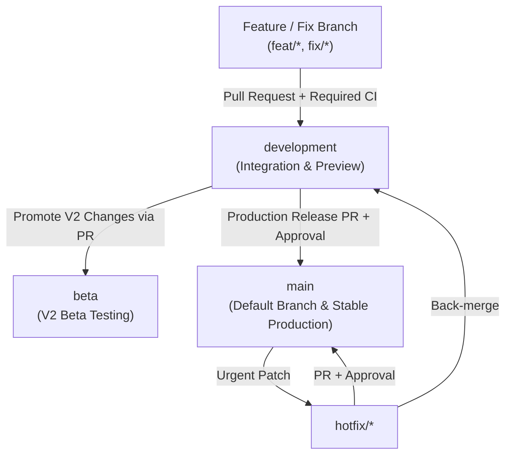

# Branching Strategy & Promotion Lifecycle

This document defines the formal branching model, pull request governance, and deployment promotion paths for **WebPulse Analytics**.

---

## 1. Branch Topology

The repository operates on a three-tier branch architecture, maintaining `main` as the default branch and primary repository anchor for stable production releases:



### Core Branches

| Branch | GitHub Environment | Protection Level | Default? | Purpose & Deployment Target |
|---|---|---|---|---|
| **`main`** | `production` | Protected + Required Review | **Yes** | Repository default branch, source of truth for stable production (`https://app.webpulseanalytics.tech`, `https://webpulseanalytics.tech`, `https://api.webpulseanalytics.tech`). |
| **`development`** | `development` | Protected | No | Integration branch for ongoing work; automatically deploys preview builds to the `development` environment. |
| **`beta`** | `beta` | Protected | No | Dedicated release track for `apps/v2` Beta Dashboard; deploys to `https://beta.webpulseanalytics.tech` (planned / pre-configured in CI). |

> [!NOTE]
> **Branch Topology vs Monorepo Directories:**
> - Active branches on remote are `main` and `development`.
> - `beta` is the dedicated staging and release track for the V2 Beta dashboard (`apps/v2`), planned for deployment to `https://beta.webpulseanalytics.tech`. Workflows in `.github/workflows/` (`ci.yml`, `deploy.yml`, `deploy-v2.yml`) are pre-configured to trigger on `beta`.
> - There are **no separate `v1` or `v2` git branches**. V1 and V2 are independent applications coexisting in the monorepo under `apps/v1` and `apps/v2`.

> [!IMPORTANT]
> **No Separate Production Branch**: `main` serves directly as the production deployment branch. Do not create a separate `production` branch and do not rename `main`.

---

## 2. Feature Development Workflow

1. **Branch Creation**:
   Always branch from the latest `development`:
   ```bash
   git checkout development
   git pull origin development
   git checkout -b feat/your-feature-name
   ```
2. **Local Validation**:
   Before opening a pull request, ensure tests and linters pass:
   ```bash
   npm run lint:all
   npm run check:backend
   npm run test:backend
   ```
3. **Pull Request to `development`**:
   - Every pull request must target `development`.
   - Automated status checks must pass:
     - **CI**: Marketing build, V1 build, V2 build, Backend tests, Migration checks.
     - **Security**: Dependency audits (`npm audit`), secret scanning (`gitleaks`).
     - **CodeQL**: Static code analysis.
     - **Dependency Review**: Checks for vulnerable new dependencies.
4. **Merge**:
   - Merge via squash or rebase merge once required reviews and checks pass.
   - Merging to `development` triggers preview builds in the `development` environment.

---

## 3. Beta Promotion Path (`apps/v2`)

When enhancements to the V2 dashboard are ready for external customer beta testing:

1. Open a Pull Request from `development` to `beta`:
   - Title: `release(beta): sync V2 dashboard enhancements`
   - Review changes to ensure no breaking schema changes are unmigrated.
2. Merge the PR into `beta`.
3. The `deploy.yml` orchestrator triggers `deploy-v2.yml` targeting the `beta` environment.
4. Deployment reaches `https://beta.webpulseanalytics.tech`.
5. **Safety Guarantee**: The orchestrator strictly ignores `apps/marketing` and `apps/v1` during beta deployments, ensuring stable production remains untouched.

---

## 4. Production Promotion Path

Stable releases require a controlled promotion from `development` to `main`:

1. **Pre-requisite Verification**:
   - [ ] All features on `development` have passed CI and security scanning.
   - [ ] If database changes are required, migrations in `supabase/migrations/` have been manually reviewed, tested on staging, and applied to production.
   - [ ] V1 dashboard features and marketing copy are verified.
2. **Open Production PR**:
   - Pull request: `development` → `main`.
   - Title format: `release(prod): vX.Y.Z promotion`.
3. **Mandatory Approvals**:
   - At least 1 senior maintainer approval.
   - GitHub Environment protection gate (`production`) prompts for authorized release approval.
4. **Automated Production Deployment**:
   - Merging into `main` triggers `deploy.yml`, which resolves `ENV="production"`.
   - `deploy.yml` triggers `deploy-marketing.yml`, `deploy-v1.yml`, and `deploy-backend.yml` against the `production` environment.
   - V1 Dashboard is deployed to `https://app.webpulseanalytics.tech`.
   - Marketing is deployed to `https://webpulseanalytics.tech`.
   - Backend is triggered on the designated persistent host (`https://api.webpulseanalytics.tech`).
5. **Release Tagging**:
   - After verified deployment, tag the release:
     ```bash
     git checkout main
     git pull origin main
     git tag -a v1.1.0 -m "Release v1.1.0: production deployment"
     git push origin v1.1.0
     ```

---

## 5. Hotfix Workflow

In the event of an urgent production issue:

1. Branch directly from `main`:
   ```bash
   git checkout main
   git pull origin main
   git checkout -b hotfix/critical-fix
   ```
2. Commit the fix and open a PR targeting `main`.
3. Following approval and automated deployment to `main`, back-merge the hotfix into `development`:
   ```bash
   git checkout development
   git pull origin development
   git merge --no-ff hotfix/critical-fix
   git push origin development
   ```

---

## 6. Branch Protection Governance

For the ready-to-import ruleset JSON and exact administrative setup steps for `main`, see [docs/branch-protection.md](branch-protection.md).

Configure branch protection rules under **Settings** → **Branches** or **Settings** → **Rules** for `main`, `beta`, and `development`:

- **Require a pull request before merging**: Enabled (minimum 1 approval for `main`).
- **Require status checks to pass before merging**: Enabled.
  - Required checks: `CI`, `Security`, `CodeQL`.
- **Require branches to be up to date before merging**: Enabled.
- **Do not allow force pushes**: Enabled for all branches.
- **Do not allow deletions**: Enabled for all branches.
